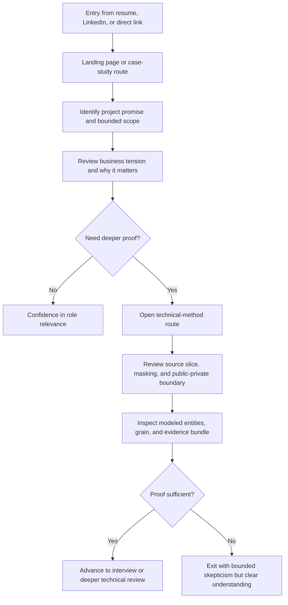
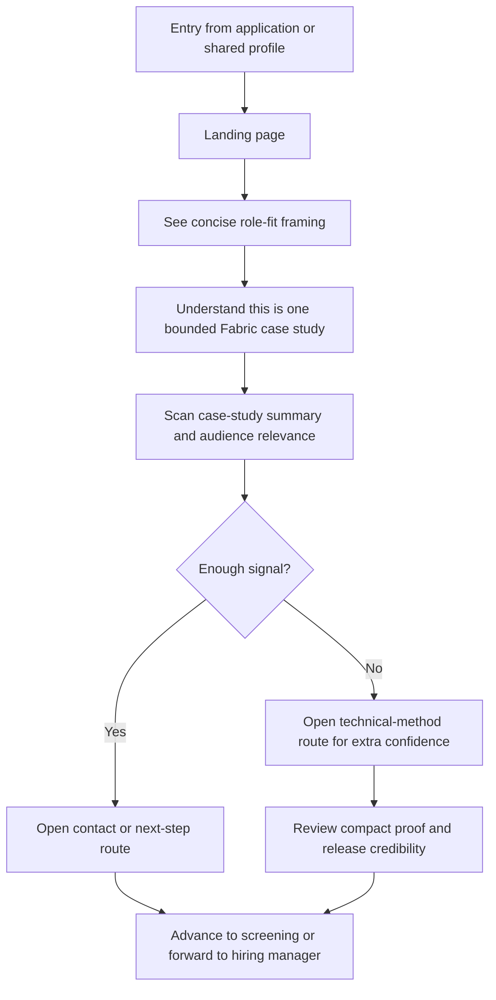
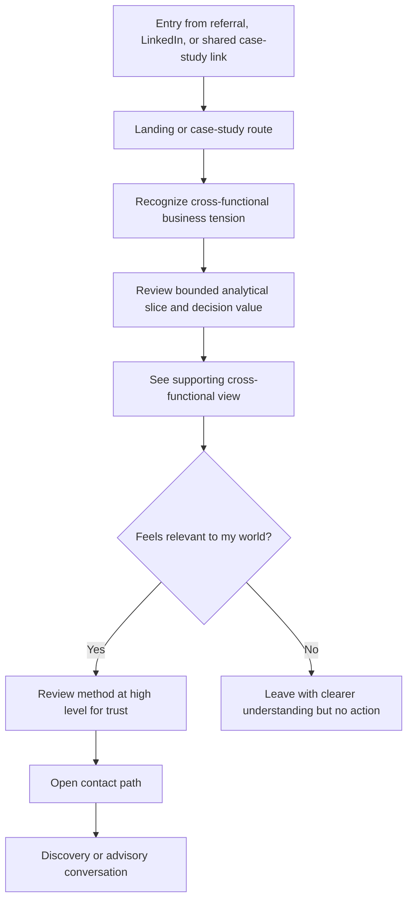

---
stepsCompleted:
  - 1
  - 2
  - 3
  - 4
  - 5
  - 6
  - 7
  - 8
  - 9
  - 10
  - 11
  - 12
  - 13
  - 14
lastStep: 14
inputDocuments:
  - _bmad-output/planning-artifacts/product-brief-FABRIC_PLATFORM_DEV_BMAD-2026-03-20.md
  - _bmad-output/planning-artifacts/prd.md
  - _bmad-output/planning-artifacts/prd-sweep-architecture-learning-client-enablement-2026-03-27.md
  - docs/client-enablement/us-en/public-facing/privacy-policy.md
  - docs/client-enablement/shared/discovery/client-discovery-brief-template.md
date: 2026-03-27
author: Manuel
---

# UX Design Specification FABRIC_PLATFORM_DEV_BMAD

**Author:** Manuel
**Date:** 2026-03-27

---

<!-- UX design content will be appended sequentially through collaborative workflow steps -->

## Executive Summary

### Project Vision

FABRIC_PLATFORM_DEV_BMAD is a public-facing analytical case-study experience that demonstrates how real operational complexity can be transformed into a publication-safe, credible Microsoft Fabric product. The UX goal is not to showcase interface novelty for its own sake, but to make a serious business problem easy to understand, believable to mixed audiences, and strong enough to support hiring and consulting conversations from one shared surface.

The experience should guide users through a deliberate narrative sequence: first understand the business tension, then see how the analytical model clarifies it, and finally discover the technical credibility behind the solution. Supporting pages such as privacy and terms should reinforce trust, clarity, and professionalism without distracting from the core case-study flow.

### Target Users

Primary UX audiences are hiring managers and technical evaluators who need fast proof of real-world judgment, recruiters who need a concise role-fit signal, and business-side analytics sponsors or consulting prospects who need to recognize a familiar class of operational problem.

These audiences have different levels of technical depth, but they should not require separate products. The UX should let each audience succeed from the same experience through strong hierarchy, progressive disclosure, and clear route responsibilities.

### Key Design Challenges

The biggest UX challenge is serving mixed audiences without fragmenting the experience into separate business and technical tracks. The product must stay business-readable while still exposing enough technical evidence to withstand skeptical review.

A second challenge is keeping the public surface focused on one bounded case study instead of letting supporting material, including legal and trust pages, dilute the main narrative. A third challenge is making complex analytical content feel approachable on both desktop and mobile without flattening its seriousness.

### Design Opportunities

The strongest opportunity is to create a business-first storytelling system that turns analytical rigor into something understandable within minutes. Progressive disclosure can let users move from high-level problem framing into methodology, model logic, and proof artifacts only when they want deeper detail, including a compact cue for what technical proof is included in Phase 1 and what is intentionally deferred.

There is also a trust-design opportunity: public-facing support pages like the privacy policy, contact handling notice, and terms can feel like part of one coherent credibility system rather than disconnected compliance leftovers. If done well, they strengthen confidence in the product and in the person behind it.

## Core User Experience

### Defining Experience

The core experience of FABRIC_PLATFORM_DEV_BMAD is a guided proof journey, not open-ended exploration. The product should help each visitor build confidence in a deliberate sequence: first understand the business tension, then see how the analytical model clarifies it, and finally confirm that the work is technically and professionally credible.

The most important recurring user action is not clicking a specific control, but reaching trust quickly. A visitor should be able to scan the experience and decide within minutes that this is a serious, relevant, and well-structured analytical product rather than a generic portfolio artifact. The UX should therefore reduce ambiguity, preserve narrative momentum, and keep the proof ladder visible across the shared public surface.

### Platform Strategy

The primary platform is an SEO-forward multi-page web experience designed for desktop and mobile review. Desktop should support deeper inspection of analytical and technical evidence, while mobile must still preserve the same reading sequence and make orientation, navigation, and next-step actions easy to use.

The interaction model should prioritize content-first browsing with lightweight enhancement rather than app-like complexity. Mouse-and-keyboard use remains primary, with touch-friendly responsive behavior as a required support mode. Offline behavior is not a core requirement. Performance, readability, accessibility, and stable shareable routes matter more than rich interface mechanics.

### Effortless Interactions

Visitors should be able to answer four questions with almost no friction: what this project is, why it matters, why they should trust it, and what to do next. Moving from overview to case study to technical method should feel natural, predictable, and low-effort.

Trust-building interactions should feel equally effortless. Users should be able to find freshness cues, publication-safe framing, methodological boundaries, and supporting trust pages such as privacy and contact handling without feeling pulled away from the main story. The experience should never force users to choose too early between business clarity and technical depth.

### Critical Success Moments

The first critical success moment happens when a visitor quickly realizes this is not a generic data portfolio piece but a credible analytical case grounded in real cross-functional tension. The second happens when the analytical view makes the demand-to-inventory-readiness problem concrete enough that the business value feels immediately understandable.

The make-or-break technical moment occurs when a skeptical reviewer can find enough evidence of scope discipline, abstraction logic, and implementation seriousness from within the same shared experience. The final success moment is when the visitor has confidence in the next action, whether that means deeper review, professional contact, or a consulting conversation.

### Experience Principles

- Lead with business tension before technical explanation.
- Structure the experience as progressive proof, not just progressive disclosure.
- Keep route purpose obvious so the shared public surface never feels fragmented.
- Make trust signals visible without letting legal or support content overpower the case-study narrative.
- Ensure every audience can reach confidence quickly from the same experience, even if they stop at different depths.

## Desired Emotional Response

### Primary Emotional Goals

The primary emotional goal is confident trust. Users should feel that they are looking at work that is serious, thoughtful, and grounded in real analytical judgment rather than presentation theater. The experience should create a sense of clarity, credibility, and professional respect within the first few minutes.

A secondary goal is engaged curiosity. Once trust is established, users should feel invited to go deeper into the case, the methodology, and the technical proof without feeling intimidated or overloaded. For business-facing users, this should feel practical and relevant. For technical reviewers, it should feel defensible and worth closer inspection.

### Emotional Journey Mapping

At first discovery, users should feel oriented and reassured. The project should immediately communicate that it is focused, real, and publication-safe, reducing the skepticism that often comes with public portfolio work.

During the core experience, users should feel increasingly confident and interested as the case-study story becomes more concrete. As they move into analytical and technical material, the desired feeling is not surprise for its own sake, but growing conviction that the work is coherent and credible.

After completing the main flow, users should feel informed, impressed, and clear about the next step. If something is missing or unclear, the emotional fallback should still be calm trust rather than frustration, with the experience signaling boundaries and support pages clearly enough to prevent anxiety or confusion. On return visits, the product should feel stable, maintained, and increasingly trustworthy.

### Micro-Emotions

The most important micro-emotions are confidence over confusion, trust over skepticism, focus over overwhelm, and accomplishment over friction. These matter more than playful delight because the product’s value depends on helping users understand a serious analytical story quickly.

A smaller but still important emotional layer is intellectual satisfaction. Users should feel that the experience is well-composed, that each page has a purpose, and that deeper details reward attention instead of punishing it. This is especially important for technical evaluators and consulting prospects.

### Design Implications

To create confidence, the UX should emphasize strong hierarchy, explicit route purpose, clear methodological boundaries, and visible trust signals such as freshness context, publication-safe framing, and accessible support pages. To create curiosity, the experience should use progressive proof so each deeper layer feels earned and useful rather than dense or premature.

To avoid skepticism, the design should avoid inflated claims, excessive visual drama, and anything that feels like generic portfolio marketing. To avoid overwhelm, the UX should keep the narrative sequence stable, reduce jargon at the entry points, and make it easy for users to choose their depth without losing orientation.

### Emotional Design Principles

- Build trust before asking for deep attention.
- Replace skepticism with clarity through explicit structure and restrained claims.
- Make seriousness feel approachable, not dry or intimidating.
- Reward deeper reading with stronger proof, not more noise.
- Ensure support pages such as privacy and contact handling reinforce calm professionalism rather than compliance anxiety.

## UX Pattern Analysis & Inspiration

### Inspiring Products Analysis

Three strong inspiration sources for this project are Stripe, Notion, and GitHub.

Stripe is relevant because it makes complex technical and business material feel trustworthy, structured, and readable. Its strongest pattern is progressive explanation: high-level value first, deeper technical detail second, and proof artifacts close at hand. That matches this project's need to support both business-facing and technical readers without splitting the experience.

Notion is relevant because it handles dense information with calm hierarchy and low-friction navigation. It shows how long-form, layered content can still feel approachable when typography, spacing, and sectioning are disciplined. That is useful for a case-study product that must feel serious without becoming visually exhausting.

GitHub is relevant because it supports credibility through transparency. Users feel they can inspect the work, trace decisions, and go deeper when needed. For this project, GitHub is less a visual model and more a trust model: visible evidence, stable structure, and clear next actions increase confidence for technical reviewers and hiring audiences. The transferable lesson is curated transparency, not publishing the entire internal workshop.

### Transferable UX Patterns

**Navigation Patterns**

- Clear route ownership: each page should have one main job, such as orientation, case-study proof, technical method, or contact.
- Progressive depth: users should be able to move from summary to detail without losing context.
- Persistent orientation: section labels, headings, and local navigation should keep users aware of where they are in the proof journey.

**Interaction Patterns**

- Progressive proof: reveal evidence in layers so users gain confidence step by step instead of facing a wall of detail.
- Context-first reading: explain why something matters before showing how it was built.
- Frictionless trust cues: make freshness, publication-safe framing, and methodological boundaries easy to find without interrupting flow.

**Visual Patterns**

- Calm, disciplined typography that supports long-form reading.
- Strong spacing and content chunking to make dense material feel manageable.
- Restrained visual emphasis so important proof moments stand out without turning the site into marketing theater.

### Anti-Patterns to Avoid

- Portfolio-showcase aesthetics that prioritize style over credibility and make the work feel generic.
- Dense technical dumps too early in the experience, which can overwhelm recruiters and business-facing readers before trust is established.
- Overly clever navigation or hidden structure that forces users to guess where business framing, technical proof, or support pages live.
- Compliance content that feels isolated, alarming, or bolted on instead of integrated into the overall trust system.
- Excessive motion, decoration, or dashboard clutter that competes with the seriousness of the analytical story.
- Treating public transparency as a full internal process dump instead of a curated proof layer.

### Design Inspiration Strategy

**What to Adopt**

- Stripe's model of business clarity first, technical proof second.
- Notion's calm information hierarchy and readable long-form structure.
- GitHub's trust-through-transparency approach for technical credibility and inspectability.

**What to Adapt**

- Technical-proof patterns should be adapted into a curated public case-study flow rather than a repo-first experience.
- Long-form structure should be simplified so mixed audiences can stop at different depths without losing the main story.
- Trust pages such as privacy and contact handling should borrow the same visual and structural discipline as core pages so they feel native to the product.

**What to Avoid**

- Copying product aesthetics without copying the underlying clarity.
- Turning the site into a documentation portal when the main goal is guided analytical proof.
- Treating support pages as legal leftovers rather than as part of the credibility experience.
- Exposing reusable internal playbooks or private delivery leverage under the banner of transparency.

## Design System Foundation

### 1.1 Design System Choice

FABRIC_PLATFORM_DEV_BMAD should use a lightweight custom design system built specifically for the public case-study experience. The foundation should be token-driven and implemented through Astro-first components, semantic HTML, CSS variables, and a small curated set of reusable UI patterns rather than a large general-purpose component framework.

This is closer to a custom system than to Material Design, Ant Design, or a full themeable UI kit. The goal is not to build a broad enterprise design system in Phase 1, but to define a disciplined visual and interaction foundation that supports trust, readability, accessibility, and performance.

### Rationale for Selection

A heavy established system would speed up some component work, but it would also push the product toward generic app patterns that do not fit a proof-focused, content-first public case-study site. This product needs stronger editorial control, calmer information hierarchy, and a more intentional trust posture than a standard dashboard or admin-style library would provide.

A lightweight custom system is the best fit because it supports the architecture already chosen: static-first Astro delivery, low JavaScript overhead, route-specific storytelling, and solo-builder maintainability. It also gives enough visual distinction to avoid looking like a template while keeping the surface bounded and professional.

### Implementation Approach

The implementation should begin with a small token layer covering color, type scale, spacing, radius, borders, elevation, and motion rules. On top of that, the site should define a compact component set for the real MVP needs: layout shell, navigation, section headers, proof cards, callout blocks, metadata rows, evidence panels, contact blocks, and legal/support page patterns.

Astro components should be the default building blocks, with framework-driven interactivity added only where clearly necessary. If a utility layer is helpful for speed, it should remain subordinate to the custom design tokens and component rules rather than becoming the design system itself.

### Customization Strategy

The visual language should be tailored to the product's emotional goals: confident, calm, structured, and technically credible. Typography should support long-form reading and scanning, color should reinforce seriousness without feeling cold, and motion should stay restrained and purposeful.

Customization should focus on what makes this case-study experience feel distinct: progressive proof layouts, trust-forward metadata treatment, bounded technical evidence surfaces, and support pages that feel native to the same product family. The system should avoid overbuilding. In Phase 1, the priority is a coherent and reusable public-proof language, not a full multi-brand component platform.

## 2. Core User Experience

### 2.1 Defining Experience

The defining experience of FABRIC_PLATFORM_DEV_BMAD is guided confidence-building through one shared public case-study flow. A visitor should be able to enter the experience, understand the business tension quickly, inspect the analytical clarification, and confirm technical credibility without feeling lost, overloaded, or forced into a separate product.

If this experience is described well by users, it should sound like this: "It takes a real business problem, explains why it matters, and lets me verify the rigor behind it without wasting my time." That is the core interaction that makes the product special.

### 2.2 User Mental Model

Users arrive with different mental models, but most begin with some skepticism. Hiring managers and recruiters expect another portfolio site and want quick proof that this is more substantial. Technical evaluators expect to test the boundaries and look for drift, missing rigor, or vague claims. Business-facing visitors expect to see whether the problem feels familiar and whether the solution pattern is credible.

Most users are already familiar with scanning structured web content, moving between summary and detail, and using links to go deeper selectively. They do not need a novel interaction pattern. They need a familiar, trustworthy reading model that removes ambiguity and helps them judge seriousness quickly.

### 2.3 Success Criteria

The core experience succeeds when users can answer four questions with very little effort: what this project is, why it matters, why they should trust it, and what to do next. It also succeeds when each audience can stop at a different depth and still feel that the experience was complete and coherent.

Success indicators include:

- users understand the business problem and route purpose within the first few minutes
- skeptical reviewers can find bounded technical proof without leaving the shared experience confused
- users feel confident enough to continue into deeper review or take a next-step action

### 2.4 Novel UX Patterns

This product should rely mainly on established patterns rather than novel interaction design. The main UX strength should come from combining familiar patterns well: content-first route structure, progressive disclosure, strong metadata treatment, and trust-building technical evidence.

The distinctive element is not a new gesture or control model. It is the way familiar patterns are sequenced into progressive proof. The unique twist is that business readability, technical credibility, and bounded transparency all live inside one intentional experience instead of being split into separate surfaces.

### 2.5 Experience Mechanics

**1. Initiation:**
The user begins from a landing page, direct case-study link, technical-method route, or shared reference. Clear headings, route purpose, and visible next actions invite them into the proof flow.

**2. Interaction:**
The user scans structured sections, follows links into deeper layers, reviews bounded analytical and technical evidence, and uses the site navigation to control depth without losing context.

**3. Feedback:**
The system signals success through clarity: obvious hierarchy, trust cues, freshness metadata, publication-safe framing, and technical evidence that matches the claims being made. If a user goes deeper, they find stronger proof rather than more noise.

**4. Completion:**
The user leaves with one of three outcomes: confidence in the creator’s capability, confidence in the relevance of the case, or confidence in the next action to take. A successful ending feels clear and intentional, not abrupt or unresolved.

## Visual Design Foundation

### Color System

The color system should feel editorial, grounded, and technically credible rather than startup-generic or dashboard-loud. A warm paper-toned base paired with deep ink tones will support long-form reading, while a restrained teal-led accent system can signal trust, clarity, and analytical focus. A muted copper or amber support accent can introduce warmth for emphasis without making the experience feel playful.

Suggested semantic direction:

- background: warm paper or soft stone
- primary text: deep ink or charcoal
- primary action / trust accent: deep teal
- secondary accent: muted copper or amber
- neutral borders and surfaces: layered slate-gray neutrals
- success / warning / error states: calm, accessible semantic tones rather than highly saturated UI colors

This system should avoid high-gloss SaaS gradients, loud neon contrast, or overly dark enterprise visuals. The visual goal is composed authority, not visual spectacle.

### Typography System

Typography should support both credibility and readability. The strongest fit is an editorial-meets-technical pairing: a refined display face for major headings and a highly readable sans-serif for body content, supported by a monospace face for metadata, timestamps, labels, and technical proof references.

Suggested direction:

- display headings: a high-legibility serif with editorial gravitas
- body and interface text: a clear modern sans-serif built for sustained reading
- technical labels and proof metadata: a restrained monospace

The type hierarchy should emphasize scanning first and deep reading second. Large headings should create confidence without theatricality, while body text should remain comfortable for longer sections of explanation. The system should support strong contrast between business-facing narrative and technical reference material without feeling like two separate products.

### Spacing & Layout Foundation

The layout should feel spacious, calm, and deliberate. An 8px base spacing system is the best fit because it creates consistency without feeling cramped, and it supports both editorial layouts and structured technical evidence blocks.

Recommended foundation:

- 8px base spacing rhythm
- 12-column responsive desktop grid
- narrower content measure for narrative reading sections
- wider container variants for analytical proof, diagrams, and evidence panels
- strong vertical spacing between major sections to reinforce the proof sequence

The layout should privilege hierarchy over density. White space should be used to slow the reading rhythm in the right places and help users understand when they are moving from orientation to evidence to next-step actions.

### Accessibility Considerations

The visual foundation should target a practical WCAG 2.2 AA-aligned baseline from the start. That means color choices must maintain strong contrast, type must remain readable at long-form lengths, and technical evidence blocks must not rely on color alone to communicate meaning.

Key accessibility principles:

- minimum readable body size with generous line height
- strong contrast across paper, ink, and accent combinations
- visible focus states that feel intentional within the design language
- meaningful hierarchy through size, weight, spacing, and labeling rather than color alone
- restrained motion with reduced-motion support for any animated transitions
- layouts that remain coherent at zoom and on narrow mobile screens

## Design Direction Decision

### Design Directions Explored

Six visual directions were explored for FABRIC_PLATFORM_DEV_BMAD, each applying the same UX foundation through a different visual lens.

The explored directions were:

- Editorial Proof, emphasizing narrative clarity and high-trust editorial framing
- Systems Ledger, emphasizing structured metadata and operational rigor
- Calm Proof, balancing business readability with bounded technical credibility
- Warm Intelligence, emphasizing advisory warmth and human approachability
- Technical Archive, emphasizing inspectability, release discipline, and evidence density
- Structured Narrative, emphasizing stepwise explanation and guided walkthrough rhythm

Together, these directions tested different levels of density, warmth, technical sharpness, and narrative control while staying inside the same trust-first product strategy.

### Chosen Direction

The recommended direction is Calm Proof as the primary visual foundation.

This direction should be treated as the lead system because it best supports the shared public experience: business tension first, analytical clarification second, and technical credibility third. It is the most balanced option for mixed audiences and gives the product enough distinction without drifting into either generic portfolio styling or overly severe technical presentation.

Supporting elements should be borrowed selectively from other directions:

- use some of Editorial Proof's headline warmth and narrative composure
- use some of Technical Archive's evidence-panel styling for the technical-method route

### Design Rationale

Calm Proof is the strongest fit because it supports long-form reading, fast scanning, and bounded technical inspection at the same time. It aligns with the emotional goals already defined: confident trust, engaged curiosity, and calm professionalism.

It also reinforces the repo and publication-boundary thinking established elsewhere in planning. The visual language can communicate rigor and transparency without implying that every internal artifact must be exposed. That makes it a strong match for curated public proof rather than full process disclosure.

### Implementation Approach

Implementation should use Calm Proof as the default design direction for the landing, case-study, and contact-supporting routes. The technical-method route can adopt a slightly sharper evidence treatment inspired by Technical Archive, while keeping the same core type, spacing, and color system.

In practice, this means:

- use the calm paper-and-ink palette with teal-led trust accents as the default system
- keep editorial spacing and readable content widths for business-facing sections
- use denser metadata and evidence cards only where technical credibility needs to be surfaced
- preserve one coherent product family across all routes rather than creating visually disconnected business and technical experiences

## User Journey Flows

### Hiring Manager / Technical Evaluator Review Flow

This flow is for the mixed technical reviewer who wants fast proof first and deeper rigor second. The experience should let them enter from a direct case-study link or landing page, understand the business problem quickly, and then verify the technical method without feeling diverted into a disconnected product.

### Recruiter Fast Qualification Flow

This flow is optimized for speed and clarity. The recruiter should be able to summarize the project quickly, understand role fit, and identify the next action without needing deep Fabric knowledge.

### Business-Side Sponsor / Consulting Prospect Flow

This flow is designed for a business-facing visitor who wants to know whether the case maps to a familiar class of operational problems. The experience should emphasize recognition, credibility, and a clear path to conversation.

### Journey Patterns

Across these flows, several reusable patterns should be standardized:

- Entry paths should support both overview-first and direct deep-link behavior without breaking orientation.
- Every major route should answer a different question: what is this, why does it matter, how does it work, what should I do next.
- The case-study route should remain the primary proof surface, with the technical-method route acting as a deeper validation layer rather than a second product.
- Trust cues such as freshness, bounded scope, masking posture, and release credibility should appear before users need to search for them.
- Contact and next-step actions should be available at the right moments without interrupting the proof flow too early.

### Flow Optimization Principles

- Minimize steps to confidence, not just steps to content.
- Preserve the reading sequence of business tension first, analytical clarification second, and technical credibility third.
- Let users choose depth without losing context or route orientation.
- Use progressive proof so deeper inspection increases confidence instead of increasing noise.
- Fail gracefully: if users do not continue, they should still leave with a coherent understanding of the project.

## Component Strategy

### Design System Components

The lightweight custom design system defined earlier already covers the structural foundation needed for the MVP. Foundation components should include:

- layout shell
- primary navigation
- section wrapper
- heading block
- text block
- button and link treatments
- basic card and panel containers
- metadata row patterns
- callout and notice blocks
- form field and contact-action patterns
- divider, tag, badge, and list treatments

These components should be implemented as simple Astro-first primitives using shared tokens for color, type, spacing, radius, border, and motion. They provide the baseline consistency for the product without forcing the experience into a generic application framework.

### Custom Components

### Proof Ladder Section

**Purpose:** Help users move through the intended reading sequence from business tension to analytical clarification to technical credibility.  
**Usage:** Used on landing and case-study routes as the core narrative scaffolding.  
**Anatomy:** Section label, short summary, evidence cue, optional next-step link.  
**States:** default, hover for linked variants, active/current section.  
**Variants:** compact, standard, featured.  
**Accessibility:** semantic heading structure, clear link labels, keyboard-focusable when interactive.  
**Content Guidelines:** Keep copy concise and directional; each block should answer one user question.  
**Interaction Behavior:** Supports scanning first, then deeper entry into the next proof layer.

### Primary Analytical Visualization Object

**Purpose:** Represent the main analytical view that proves the case, regardless of whether the final rendering engine is Fabric, Power BI, exported media, or a custom web implementation. In this project, that primary object should be supply-chain centered.  
**Usage:** Used on the primary case-study route as the central evidence object around which surrounding explanation, freshness, and boundary cues are organized.  
**Anatomy:** title, analytical frame, visualization surface, metric legend or caption, interpretation note, freshness context, publication-boundary cue, optional deeper-proof link.  
**States:** loading, ready, narrow viewport adaptation, stale-warning, unavailable fallback, bounded-note visible.  
**Variants:** static publication snapshot, guided interactive view, annotated comparison view, external-proof-linked view.  
**Accessibility:** requires adjacent interpretation text, non-color-only encoding, keyboard access for any controls, and a text-equivalent explanation of the key insight.  
**Content Guidelines:** Define this as a stable UX object, not as a vendor-specific widget. The user should understand what decision signal the object provides even if the implementation engine changes later. The decision signal should answer the supply-chain question first: whether inventory posture is aligned with expected demand and target service conditions. The object should read like bounded decision support, not like a public imitation of an ERP or planning-suite control tower.  
**Interaction Behavior:** The object should deepen comprehension without breaking the narrative flow. Any interaction should stay lightweight, bounded, and clearly subordinate to the curated public experience.

### Supporting Analytical View Object

**Purpose:** Explain why the primary supply-chain view is under pressure or how its implications can be executed across the network.  
**Usage:** Used on the main case-study route after the primary analytical visualization or as a supporting section within the same story flow.  
**Anatomy:** title, supporting question, visualization surface or comparison frame, short interpretation note, clear relationship to the main view.  
**States:** loading, ready, narrow viewport adaptation, unavailable fallback.  
**Variants:** sales-demand context view, logistics-distribution context view.  
**Accessibility:** requires adjacent interpretation text, non-color-only encoding, keyboard access for any controls, and a text-equivalent explanation of the key insight.  
**Content Guidelines:** Supporting views should remain subordinate to the primary decision object. They should explain demand pressure or logistics consequences without creating a second disconnected product. If a view starts introducing its own policy engine or standalone workflow, it has already exceeded the MVP boundary.  
**Interaction Behavior:** Expand the decision context without forcing users into dashboard mode or breaking the business-first reading sequence.

### Evidence Panel

**Purpose:** Present technical credibility without overwhelming the main narrative.  
**Usage:** Used on the technical-method route and in selected case-study inserts.  
**Anatomy:** title, short explanation, metadata row, optional source or release reference, optional status indicator.  
**States:** default, emphasis, warning or bounded note.  
**Variants:** architecture, release, validation, masking, lineage.  
**Accessibility:** do not rely on color alone for status; support readable labels and text alternatives.  
**Content Guidelines:** Show bounded proof only; do not expose private-only or internal-operating assets.  
**Interaction Behavior:** Expand understanding, not complexity; should feel inspectable but compact.

### Freshness and Release Status Block

**Purpose:** Make recency, release identity, and trust signals visible.  
**Usage:** Case-study route, technical-method route, and selected footer or status areas.  
**Anatomy:** timestamp, release identifier, validation state, short note.  
**States:** current, stale-warning, validation-note.  
**Variants:** inline strip, compact card, route-header metadata.  
**Accessibility:** human-readable text plus machine-readable date support where useful.  
**Content Guidelines:** Always pair freshness with interpretation so users do not assume real-time behavior.  
**Interaction Behavior:** Passive trust cue; should not require user effort to understand.

### Boundary Classification Callout

**Purpose:** Explain what is public, masked, synthetic, omitted, or private-only.  
**Usage:** Technical-method route and selected proof sections.  
**Anatomy:** boundary label, short explanation, optional examples of what is included versus excluded.  
**States:** neutral, cautionary, explanatory.  
**Variants:** inline note, grouped matrix, side callout.  
**Accessibility:** explicit text labels and structured lists.  
**Content Guidelines:** Clarify boundaries confidently without sounding evasive.  
**Interaction Behavior:** Reduce skepticism by making omission feel intentional and disciplined.

### Contact Intent Block

**Purpose:** Help users choose the right next-step action based on intent.  
**Usage:** Contact or next-step route, plus selective CTA placements.  
**Anatomy:** audience label, short value statement, recommended action.  
**States:** default, hover, selected if interactive.  
**Variants:** recruiter, hiring manager, consulting prospect.  
**Accessibility:** large click targets, clear labels, keyboard support.  
**Content Guidelines:** Keep action language concrete and low-friction.  
**Interaction Behavior:** Convert confidence into action without breaking the calm tone.

### Component Implementation Strategy

Use a layered strategy:

- foundation primitives first
- route-specific composites second
- specialized proof components third

Foundation primitives should stay highly reusable and visually quiet. Composite components should encode the real UX patterns of this product, especially progressive proof, bounded transparency, and trust-forward metadata. Specialized components should be created only where the MVP needs them, not because a generic design system would normally include them.

The primary analytical visualization should be implemented as a stable product object with a separate rendering contract underneath it. That keeps the UX consistent whether the final implementation uses a Fabric artifact, Power BI embed, exported image, or a more practical custom web visualization later.

All custom components should inherit from the same token layer and use consistent spacing, type hierarchy, and interaction states. Accessibility should be designed into each component from the start rather than added later.

### Implementation Roadmap

**Phase 1 - Core Components**

- layout shell
- primary navigation
- section wrapper and heading block
- proof ladder section
- primary analytical visualization object
- button and link system
- contact intent block

**Phase 2 - Trust and Evidence Components**

- evidence panel
- freshness and release status block
- boundary classification callout
- metadata row and tag system

**Phase 3 - Supporting Enhancements**

- richer supporting analytical view containers
- reusable legal and support-page patterns
- optional route-local comparison or evidence toggles if later needed

This roadmap keeps the MVP focused on the components that directly support user trust, route clarity, and proof navigation.

## UX Consistency Patterns

### Button Hierarchy

**When to Use:** Use one primary action per section when the user is expected to continue the proof journey or take a next-step action. Use secondary actions for optional exploration and tertiary text links for low-friction supporting paths. Avoid multiple visually dominant actions competing within the same viewport.

**Visual Design:** Primary buttons should use the strongest trust accent and appear only at true decision points. Secondary buttons should remain quieter but clearly interactive. Text links should feel editorial and intentional, not decorative.

**Behavior:** Primary actions should move the user forward in the narrative or into the next valid depth level. Secondary actions should open supporting material without breaking orientation. External or evidence-link actions should be explicitly labeled so users know they are leaving the main flow.

**Accessibility:** All buttons and links require clear text labels, visible focus states, keyboard access, and sufficient contrast. Icon-only buttons should be avoided unless they include an accessible name and have an obvious convention.

**Mobile Considerations:** Primary and secondary actions need comfortable tap targets and clear spacing. Stacked action groups are preferred over crowded inline controls.

**Variants:** primary, secondary, tertiary text link, subdued metadata link.

### Feedback Patterns

**When to Use:** Feedback should appear whenever the product needs to clarify system state, proof boundaries, freshness, validation posture, or contact-form status. The tone should stay calm and specific rather than app-like or alarmist.

**Visual Design:** Use restrained notice styles with clear labels and concise explanation. Warning patterns should communicate boundedness or staleness without implying failure unless there is a real failure condition. Success states should feel quiet and professional rather than celebratory.

**Behavior:** Feedback should answer what happened, what it means, and whether the user needs to do anything next. Passive trust cues such as freshness and release status should remain visible without interrupting reading flow.

**Accessibility:** Status messages should not rely on color alone. Important updates should be announced semantically where appropriate, especially after form submission or validation events.

**Mobile Considerations:** Notices should compress vertically without hiding key meaning. Keep labels short and interpretation text scannable.

**Variants:** info, bounded-note, freshness note, stale-warning, validation success, error, unavailable-state.

### Form Patterns

**When to Use:** Forms should remain minimal and appear only where they support a clear next-step action, such as contact or inquiry intent. The product does not need form-heavy workflows in Phase 1.

**Visual Design:** Use clean single-column layouts, explicit labels, supportive helper text, and quiet privacy reassurance near submission. Inputs should feel native to the same trust-first system as the case-study routes.

**Behavior:** Validation should happen clearly and close to the field. Required fields should be minimal. Submission should confirm what was sent, what happens next, and what data handling boundary applies.

**Accessibility:** Every field requires a persistent label, programmatic error association, keyboard support, and clear focus styling. Placeholder-only labeling should be avoided.

**Mobile Considerations:** Single-column inputs, full-width controls, and low-friction keyboards for email or message entry. Error recovery should not require excessive scrolling.

**Variants:** contact inquiry, recruiter interest, consulting inquiry, lightweight newsletter or follow-up capture only if later justified.

### Navigation Patterns

**When to Use:** Navigation should preserve route purpose and proof orientation at all times. Users should always know whether they are in orientation, case-study proof, technical method, or next-step space.

**Visual Design:** Global navigation should stay compact and stable. Local navigation should appear only when it helps users move through a longer proof sequence. Current location indicators should be visible but understated.

**Behavior:** Navigation should support both top-down reading and direct deep-link entry. The product should always provide a clean path back to the main case narrative from deeper technical sections. Route labels should reflect purpose, not clever naming.

**Accessibility:** Use semantic landmarks, meaningful link text, logical tab order, and clear current-page indication. Skip links should be available on longer pages.

**Mobile Considerations:** Mobile navigation should prioritize route clarity over feature density. Keep the route list short and avoid layered menu complexity.

**Variants:** global route navigation, local section navigation, proof-ladder navigation, footer trust navigation.

### Additional Patterns

#### Analytical Object Patterns

**When to Use:** Apply these patterns whenever the main analytical visualization or supporting evidence object appears.

**Visual Design:** Each analytical object should include an interpretation frame, supporting metadata, and a visible indication of whether the object is live, static, curated, or bounded.

**Behavior:** Users should be able to understand the main insight without manipulating the object. If interaction is offered, it should be lightweight, obvious, and non-essential to basic comprehension.

**Accessibility:** Provide text interpretation, non-color encoding, and keyboard support for any interactive controls. The object should never be the only place where meaning is communicated.

**Mobile Considerations:** Prefer simplified or stacked presentation over cramming a desktop visualization into a narrow screen.

#### Empty, Loading, and Unavailable States

**When to Use:** Use these states when an analytical object, evidence panel, or contact action is not yet ready, has no relevant data, or is intentionally unavailable in the public version.

**Visual Design:** Keep states informative and calm. Unavailable states should explain whether the absence is temporary, scoped, or intentionally withheld for publication-safety reasons.

**Behavior:** Loading states should indicate structure, not fake precision. Empty states should explain what is absent and why. Unavailable states should point users to an adjacent explanation or alternate proof path where possible.

**Accessibility:** Status text should be explicit and screen-reader friendly. Skeletons should not be the only cue.

**Mobile Considerations:** Compress state messaging to one clear explanation plus one optional next action.

#### Modal and Overlay Rules

**When to Use:** Use modals rarely. Prefer dedicated routes, inline expansion, or anchored sections over overlays.

**Visual Design:** If overlays are needed, keep them simple, focused, and easy to dismiss. They should not interrupt the main proof journey unnecessarily.

**Behavior:** Overlays should be reserved for narrow supporting tasks such as image enlargement, glossary help, or a compact evidence reference. Do not place core narrative or required proof inside a modal.

**Accessibility:** Trap focus correctly, support escape-to-close, restore focus on exit, and ensure close controls are explicit.

**Mobile Considerations:** Full-screen sheets are safer than cramped centered dialogs on small screens.

## Responsive Design & Accessibility

### Responsive Strategy

The product should follow a mobile-first responsive strategy, but it should not be mobile-equal in density. Mobile must preserve the proof sequence and core trust signals, while desktop can support deeper inspection, richer side-by-side layouts, and stronger analytical framing.

On desktop, the experience should take advantage of wider screens for clearer narrative-to-evidence relationships. This is the best place for multi-column layouts, adjacent metadata, sticky local navigation, wider analytical objects, and denser technical proof panels. The desktop goal is depth without clutter.

On tablet, the experience should simplify density while preserving structure. Two-column layouts may still work in selected sections, but the product should prefer comfortable touch targets, reduced side-by-side complexity, and clearer vertical grouping. Tablet should feel like a readable bridge between desktop depth and mobile focus.

On mobile, the design should prioritize sequence, clarity, and trust. The most important information should appear in this order: route purpose, business framing, analytical insight, bounded proof cues, and next action. Navigation should stay compact, analytical objects should simplify or stack, and supporting technical detail should collapse into clearly labeled sections rather than shrink into unreadable fragments.

### Breakpoint Strategy

The project should use a practical breakpoint system aligned to content behavior rather than device branding alone.

Recommended breakpoints:

- small mobile: `320px` to `479px`
- large mobile: `480px` to `767px`
- tablet: `768px` to `1023px`
- desktop: `1024px` to `1439px`
- wide desktop: `1440px+`

The implementation should remain mobile-first, using progressive enhancement as space becomes available. Layout changes should be triggered when readability, analytical object integrity, or navigation clarity would otherwise degrade, not simply because a device class changed.

The key responsive behaviors should be:

- collapse multi-column narrative layouts into one readable column on small screens
- convert dense metadata rows into stacked labeled groups on mobile
- simplify or restack the primary analytical visualization when width cannot preserve comprehension
- keep trust cues such as freshness and boundary notes visible across all breakpoints
- avoid horizontal scrolling for primary narrative or proof content

### Accessibility Strategy

The product should target WCAG 2.2 AA as the minimum practical standard for Phase 1. That is the right level for a public-facing professional case-study product that wants to signal seriousness, inclusive design discipline, and credible engineering judgment.

Accessibility priorities should include:

- semantic page structure with meaningful heading hierarchy
- full keyboard access across navigation, links, form controls, and any analytical interactions
- visible focus indicators consistent with the visual language
- color contrast that supports low-vision reading across text, controls, and notices
- touch targets of at least `44x44px` for interactive controls
- non-color-only communication for analytical meaning, statuses, and warnings
- text alternatives, captions, or adjacent explanations for charts, diagrams, and analytical visuals
- reduced-motion support for any transitions or reveal effects
- clear labels and programmatic associations for any forms

Because this product includes analytical visuals and proof objects, accessibility should focus not only on page chrome but on interpretability. Users should be able to understand the main insight of a chart or analytical object without relying solely on vision, color discrimination, or precise pointer interaction.

### Testing Strategy

Responsive and accessibility quality should be validated through a mix of manual and automated testing.

Responsive testing should include:

- viewport testing across mobile, tablet, desktop, and wide desktop breakpoints
- checks in current Chrome, Safari, Firefox, and Edge
- manual review of route hierarchy, navigation behavior, and analytical object adaptation
- performance checks on mobile-like network and device conditions for primary public routes

Accessibility testing should include:

- automated audits for common issues
- keyboard-only walkthroughs of all major routes
- screen reader spot checks using VoiceOver and at least one Windows screen reader later in validation
- zoom testing at `200%`
- reduced-motion verification
- contrast validation for text, controls, notices, and analytical encodings

The most important manual checks should focus on whether meaning survives adaptation: can users still understand the business case, the analytical point, the proof boundary, and the next action on a narrow screen or with assistive support enabled?

### Implementation Guidelines

Responsive implementation should use relative units, fluid containers, and content-aware layout rules rather than device-specific hacks. Narrative sections should optimize for readable measure, while analytical sections should use wider containers only when the content justifies it.

Accessibility implementation should prefer semantic HTML first and ARIA only where native semantics are insufficient. Developers should treat skip links, landmark regions, heading structure, focus management, and text alternatives as core implementation requirements rather than polish tasks.

Specific implementation guidance:

- use `rem`, `%`, and fluid sizing over fixed pixel-heavy layouts
- preserve readable line length for narrative sections across breakpoints
- keep analytical objects bounded and interpretable before making them interactive
- provide fallback representations when a visualization cannot remain usable on small screens
- ensure every important state has a textual explanation, not just a visual treatment
- test responsive and accessibility behavior continuously during component buildout, not only at the end
