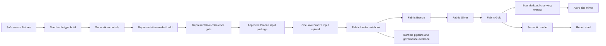
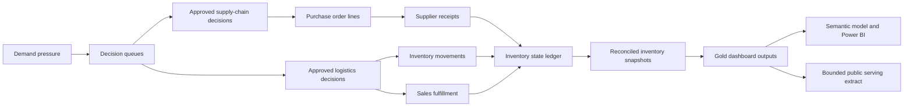

# Current Data Pipeline Description

Status: Active reference
Last updated: 2026-04-14

## Purpose

This document explains the pipeline as it exists today and the direction it is now intentionally moving toward.

It answers five questions:

- where rows are generated today
- what the repo governs
- what Fabric executes today
- what the public site reads today
- what the intended Fabric-first medallion shape is after the current correction work

Canonical terminology:

- `docs/automation/fabric-first-medallion-vocabulary.md`

Financial-layer design reference:

- `platform/fabric/contracts/financial-analytics-layer-v1-design.md`

Operating-loop architecture reference:

- `docs/automation/operating-loop-architecture.md`

Current V2 planning baseline:

- `_bmad-output/planning-artifacts/prd-v2-operating-loop-decision-system-2026-04-15.md`
- `_bmad-output/planning-artifacts/architecture-v2-operating-loop-delta-2026-04-15.md`
- `_bmad-output/planning-artifacts/oversight-map-v2-2026-04-15.md`
- `_bmad-output/planning-artifacts/scope-decisions-v2-2026-04-15.md`

## Short Version

### Current implemented state

The project currently works as a governed two-plane pipeline:

- outside Fabric, the repo handles seed creation, representative expansion, approval gates, and release governance
- inside Fabric, the proof runtime lands Bronze and derives Silver, Gold, runtime-control tables, the semantic model, and the report shell

The current operating path is:

1. Build a bounded seed archetype package from safe source fixtures.
2. Materialize generation controls from that seed.
3. Expand the seed into a representative masked market.
4. Run the coherence gate.
5. Promote the approved repo package into `platform/fabric/publication/current/`.
6. Use that package as the approved Bronze input package for Fabric.
7. Upload Bronze seed files to OneLake.
8. Run the Fabric loader notebook to materialize Bronze, Silver, and Gold inside the Lakehouse.
9. Materialize a bounded public serving extract downstream of Gold and mirror it into the Astro site.
10. Run the Fabric runtime-governance notebook or preview path to materialize `ctrl_*` tables.
11. Refresh and align the semantic model and report shell.
12. Record release identity and reconcile repo-side release pointers with Fabric-side runtime state.
13. Materialize governed change summaries and operational status.
14. Capture recoverable release snapshots and restore the last-known-good approved state when needed.

### Target intended architecture

The intended steady state is stronger than the current implementation:

- the repo remains the approval and seed-generation boundary
- the repo-approved package becomes the approved Bronze input package rather than the final public truth
- Fabric Bronze lands that bounded raw-like input
- Fabric Silver performs the main normalization, cleanup, and conformance work
- Fabric Gold remains the serving layer
- the public/site source now comes from a bounded Fabric-derived serving extract mirrored into the site repo
- the next improvement would be refreshing that extract directly from live Fabric runtime outputs instead of bounded local proof artifacts

### Operating-loop extension now materialized as bounded V1

The current product direction now has a first materialized operating-loop slice:

1. Demand pressure creates a supply-chain or logistics recommendation.
2. Approved supply-chain recommendations become purchase-order lines.
3. Approved logistics recommendations become inventory movements or sales fulfillment events.
4. Receipts, transfer arrivals, transfer shipments, and sales fulfillment change inventory state.
5. Inventory snapshots are reconciled from prior state plus executed events.
6. Gold outputs split into Sales, Supply Chain, and Inventory dashboard subjects.

This extension remains bounded and public-safe.
It does not claim ERP replacement, real-time writeback, supplier optimization, route optimization, or finance-grade valuation.

## Current System Flow

## Target Operating Loop

The current implemented state now supports this loop through demand, inbound, inventory
snapshots, decision queues, purchase-order lines, purchase-order status history,
inventory movement lines, sales fulfillment lines, Gold summaries, and financial
foundation tables. The remaining improvement is deeper causal reconciliation of
inventory snapshots from the event ledger rather than treating the event ledger as a
bounded explanatory layer beside the existing snapshot generation.

## Stage-by-Stage Description

### 1. Safe source fixtures

The bounded seed starts in:

- `tests/publication/fixtures/source-safe/`

These fixtures are public-safe inputs, not raw enterprise systems and not the final public truth.

### 2. Seed archetype package

The first governed build produces the seed archetype package:

- script: `platform/fabric/automation/build-dimensions.mjs`
- output: `platform/fabric/publication/seed/`

This stage creates the first bounded dimensions and facts used as archetypes for later governed growth.

### 3. Generation controls

The next stage materializes the internal rule tables used for governed growth:

- script: `platform/fabric/automation/materialize-generation-controls.mjs`
- output: `_bmad-output/test-artifacts/fabric-candidate/internal-controls/current/`

This layer stays repo-side for now.
Fabric-native row generation is not yet the active implemented scope.

### 4. Representative market build

The representative market is generated from the seed plus the internal controls:

- script: `platform/fabric/automation/materialize-representative-market.mjs`
- public output: `_bmad-output/test-artifacts/fabric-representative/current/`
- internal output: `_bmad-output/test-artifacts/fabric-representative/internal-controls/current/`

This is where most of the large fact-row volume is still generated today.

### 5. Coherence gate

The representative package must pass coherence checks before promotion:

- script: `platform/fabric/automation/run-representative-coherence-gate.mjs`
- report: `_bmad-output/test-artifacts/fabric-representative/representative-coherence-report.json`

The gate remains the repo-side approval boundary.

### 6. Approved Bronze input package

Once coherence is approved, the representative package is promoted to:

- `platform/fabric/publication/current/`

Important transition note:

- this directory is still the repo’s approved package
- it is no longer the intended long-term public truth
- it should now be interpreted as the approved Bronze input package during transition

### 7. Site-facing public serving extract

The Astro site now reads:

- `apps/public-site/src/data/public-serving/current/`

Current implemented behavior:

- the site-facing data is a bounded serving extract derived from the Fabric Gold reference outputs
- the site still reads mirrored JSON from the repo at build time
- the approved repo package remains the Bronze-input provenance source rather than the final public truth
- the active extract now includes a bounded economic layer with:
  - `financial-summary.json`
  - `monthly-financial-trend.json`
  - `unit-economics-reference.json`
- those economic outputs remain publication-safe and bounded
- today they include both:
  - proxy-based comparative metrics
  - bounded realized revenue and gross-margin metrics derived from fulfilled-line sales realization
- they are still not finance-grade valuation or raw invoice-source commercial reporting

Current internal financial foundation:

- design reference: `platform/fabric/contracts/financial-analytics-layer-v1-design.md`
- the current internal foundation can now be materialized into `_bmad-output/test-artifacts/fabric-financial/current/`
- that foundation now includes:
  - `dim_pricing_context`
  - `dim_cost_context`
  - `fact_cost_history`
  - `fact_price_list_history`
  - `fact_sales_realization`
- the same bounded financial foundation is now also landed into the Fabric Lakehouse as first-class tables alongside the main proof slice
- the remaining gap is no longer “no financial layer”; it is “bounded rule-derived finance rather than invoice-source finance”
- the next technical improvement is refreshing the serving extract directly from live Fabric-runtime outputs instead of bounded local proof artifacts

Legacy but still present:

- `apps/public-site/src/data/publication/current/` remains available as the older repo-mirror path, but it is no longer the active source for the main case-study or technical-method routes

### 8. Fabric Bronze upload

The Fabric proof path uploads the approved Bronze input files into OneLake:

- script: `05-compat/scripts/land_fab001_lakehouse_tables.py`
- OneLake root: `Files/fab001/current/bronze`

Current implemented behavior:

- Bronze is transported from the repo-approved package
- bounded financial-foundation CSVs are also uploaded to `Files/fab001/current/financial-foundation`
- Silver and Gold are not uploaded as authoritative payloads
- local Silver and Gold CSVs exist only as bounded reference outputs for verification

Target intended behavior:

- the repo-approved package should preserve bounded raw-like traces suitable for Bronze
- Bronze should not be described as the final already-clean public surface

### 9. Fabric loader notebook

The loader notebook is the current authoritative execution path for the proof medallion:

- notebook source: `05-compat/scripts/fab001_lakehouse_loader_notebook.py`

Current implemented behavior:

1. Reads Bronze seed files from absolute `abfss://.../Files/...` paths.
2. Writes Delta tables directly into the Lakehouse `Tables/` area.
3. Derives Silver and Gold inside Fabric.

Target intended behavior:

- Bronze preserves bounded raw-like signals
- Silver owns the conformance and cleanup work
- Gold stays downstream as serving

### 10. Fabric medallion outputs

Inside `lh_fab001_public_proof`, the notebook currently materializes:

Bronze:

- `dim_product`
- `dim_product_family`
- `dim_account`
- `dim_inventory_location`
- `fact_demand_line`
- `fact_inventory_inbound`
- `fact_inventory_snapshot`

Silver:

- `slv_demand_line_enriched`
- `slv_inventory_inbound_enriched`
- `slv_inventory_position_enriched`
- `slv_current_inventory_position`

Gold:

- `gold_supply_chain_decision_summary`
- `gold_supply_chain_action_queue`
- `gold_demand_support_account_pattern`
- `gold_demand_support_product_family`
- `gold_public_policy_reference`

Bounded financial foundation tables now also landed in the same Lakehouse:

- `dim_pricing_context`
- `dim_cost_context`
- `fact_cost_history`
- `fact_price_list_history`
- `fact_sales_realization`

Operating-loop tables now generated, landed, and mirrored as bounded V1:

- `dim_service_region`
- `dim_supplier`
- `rule_supplier_product_lead_time`
- `rule_location_transfer_lead_time`
- `rule_location_service_lead_time`
- `fact_supply_chain_decision_queue_line`
- `fact_logistics_decision_queue_line`
- `fact_purchase_order_line`
- `fact_purchase_order_status_history`
- `fact_inventory_movement_line`
- `fact_sales_fulfillment_line`

Current implemented interpretation:

- Bronze is landed input
- Silver is notebook-derived enrichment plus some interpretation
- Gold is serving

Target intended interpretation:

- Bronze is raw-like bounded input
- Silver is the main cleanup and conformance layer
- Gold is serving and the future source of the public extract

### 11. Runtime pipeline and governance tables

The runtime-orchestration layer exists in Fabric as well:

- orchestration script: `05-compat/scripts/materialize_fab001_runtime_pipeline.py`
- governance notebook: `05-compat/scripts/fab001_runtime_governance_notebook.py`

Current bounded runtime mode:

- pipeline attempt first
- direct notebook fallback if the pipeline notebook activity does not provide the required Lakehouse execution context

The governance notebook materializes:

- `ctrl_release_registry`
- `ctrl_last_known_good`
- `ctrl_runtime_job_history`
- `ctrl_asset_refresh_history`

### 12. Semantic model and report shell

The Fabric proof then aligns the serving layer with:

- semantic model: `sm_fab001_supply_chain_decision`
- report shell: `rpt_fab001_supply_chain_decision`

These assets sit on top of the bounded Lakehouse proof, not on top of the Astro site.

Current operating-loop handoff:

- semantic contract: `05-compat/contracts/fab001_semantic_model_contract.json`
- measure pack: `05-compat/contracts/fab001_measure_pack.dax`
- live sync status: `05-compat/contracts/fab001_semantic_model_sync_status.md`
- report contract: `05-compat/contracts/fab001_core_visual_contract.md`
- Desktop authoring guide: `05-compat/contracts/fab001_desktop_authoring_guide.md`

The semantic contract now covers the three dashboard views:

- `Sales Dashboard`
- `Supply Chain Decision Support`
- `Inventory Decision Support`

Current automation boundary:

- the Lakehouse has the refreshed operating-loop tables
- `materialize_fab001_semantic_model.py` can patch measures for tables already present in the live semantic model
- the live semantic model still needs a table-sync/modeling pass before every new table can receive measures automatically
- the report shell exists, but the full three-page Power BI layout remains a Desktop or Service authoring step

### 13. Release identity and reconciliation

The release layer records what was approved and how Fabric actually executed it:

- release materializer: `platform/fabric/automation/materialize-release-identity-record.mjs`
- ledger root: `_bmad-output/test-artifacts/release-ledger/`

Current implemented release records already capture:

- approved repo package identity
- proof manifest identity
- runtime pipeline evidence
- effective notebook execution evidence
- governance table visibility
- repo-side and Fabric-side release-pointer reconciliation

Release communications now also materialize:

- per-release change summaries
- current operational status
- site-facing governed release mirrors aligned to the active public-source mode

Current implemented release communications live under:

- `_bmad-output/test-artifacts/release-ledger/change-summaries/`
- `_bmad-output/test-artifacts/release-ledger/current-operational-status.json`
- `apps/public-site/src/data/release/current-operational-status.json`

Recovery readiness now also materializes:

- `_bmad-output/test-artifacts/release-ledger/recoverable-snapshots/`
- `_bmad-output/test-artifacts/release-ledger/recovery/`

## Current Runtime Truth

As of this document, the system is currently split this way:

- repo side: approval, coherence, promotion, release governance, and the mirrored serving-extract output consumed by Astro
- Fabric side: Bronze, Silver, Gold, runtime control tables, semantic/report proof

The current runtime mode remains explicitly bounded:

- `pipeline_notebook_activity`

That should still be described honestly as the current implemented state.

## What The Site Actually Shows

Today the public web routes use:

- `apps/public-site/src/data/public-serving/current/`
- `apps/public-site/src/data/release/current-operational-status.json`

That means:

- the landing page, case-study route, and technical-method route read the bounded serving extract plus governed release context
- the case-study route now also reads a governed operational-status mirror generated from the release ledger
- that operational-status mirror now separates the release-proof refresh timestamp from the latest reconciled Fabric runtime refresh timestamp so the site freshness label can stay aligned with Fabric when the serving extract is the active source
- the technical-method route explains the current proof path and the remaining gap between bounded local extract materialization and fully live Fabric-derived extract refresh
- the site is not querying the Fabric Lakehouse live at request time

## Boundaries

### Outside Fabric

Handled in the repo:

- masking and public-safe abstraction
- seed package build
- generation controls
- representative market build
- coherence gate
- promotion into the approved Bronze input package
- serving-extract mirroring into the site repo
- release ledger and reconciliation

### Inside Fabric

Handled in the proof platform:

- Bronze landing
- Silver cleanup and conformance target
- Gold serving outputs
- bounded public serving extract materialization target
- runtime governance tables
- semantic model
- report shell

## Key Files

- `docs/automation/fabric-first-medallion-vocabulary.md`
- `tests/publication/fixtures/source-safe/`
- `platform/fabric/publication/seed/`
- `platform/fabric/publication/current/`
- `apps/public-site/src/data/public-serving/current/`
- `apps/public-site/src/data/release/current-operational-status.json`
- `platform/fabric/automation/build-dimensions.mjs`
- `platform/fabric/automation/materialize-generation-controls.mjs`
- `platform/fabric/automation/materialize-representative-market.mjs`
- `platform/fabric/automation/run-representative-coherence-gate.mjs`
- `platform/fabric/automation/promote-representative-package-to-current.mjs`
- `05-compat/scripts/land_fab001_lakehouse_tables.py`
- `05-compat/scripts/fab001_lakehouse_loader_notebook.py`
- `05-compat/scripts/materialize_fab001_runtime_pipeline.py`
- `05-compat/scripts/fab001_runtime_governance_notebook.py`
- `platform/fabric/automation/materialize-release-identity-record.mjs`
- `platform/fabric/automation/materialize-release-communications.mjs`

## One-Line Summary

Right now the project is a governed repo-first approval pipeline with Fabric-native Bronze/Silver/Gold execution and a site that now reads a bounded Fabric-derived serving extract mirrored into the repo. The remaining gap is narrower: the extract is still materialized from bounded proof artifacts rather than refreshed directly from live Fabric runtime outputs.
