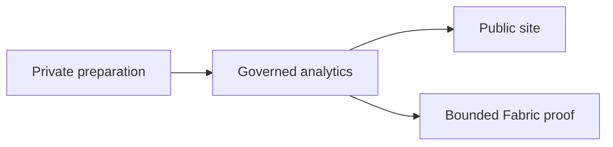
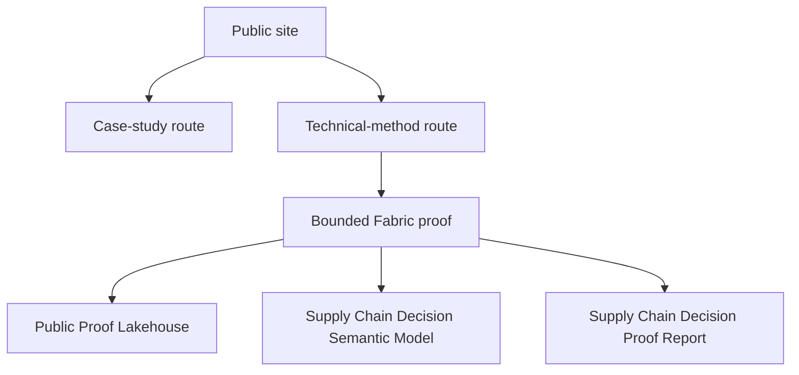
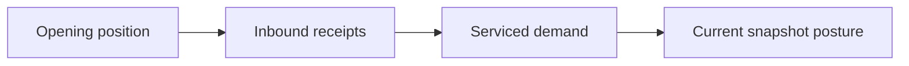

# MVP Visual Synthesis

Status: first-pass source
Last updated: 2026-04-01

## Placement Decisions

- Boundary view: `technical-method` route and public-site project map
- Operating workflow view: `technical-method` route and Fabric runbook
- Proof surface view: `technical-method` route and interview-facing explanation docs
- Inventory loop example: supporting doc only for now

## Boundary View

## Operating Workflow View

## Proof Surface View

## Inventory Loop Example

