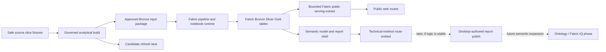
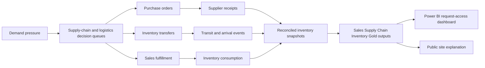

# Public-Site Project Map

Status: Active reference
Last updated: 2026-04-15

## Purpose

This document is the fastest top-down map of the current MVP.
It explains:

- what the product is
- what has already been built
- how data moves through the system
- what still remains before MVP completion
- where the next phase begins

Detailed current pipeline reference:

- `docs/automation/current-data-pipeline-description.md`

Financial-layer next-depth reference:

- `platform/fabric/contracts/financial-analytics-layer-v1-design.md`

Operating-loop next-depth reference:

- `docs/automation/operating-loop-architecture.md`

Communication strategy:

- `docs/public-site/communication-strategy.md`

Current V2 planning baseline:

- `_bmad-output/planning-artifacts/project-rebaseline-retrospective-2026-04-15.md`
- `_bmad-output/planning-artifacts/prd-v2-operating-loop-decision-system-2026-04-15.md`
- `_bmad-output/planning-artifacts/architecture-v2-operating-loop-delta-2026-04-15.md`
- `_bmad-output/planning-artifacts/epics-v2-operating-loop-decision-system-2026-04-15.md`
- `_bmad-output/planning-artifacts/oversight-map-v2-2026-04-15.md`
- `_bmad-output/planning-artifacts/scope-decisions-v2-2026-04-15.md`

## Product Thesis

The MVP is a public-safe supply-chain decision-support case.

It is not positioned as:

- an ERP replacement
- a full planning engine
- a live operational cockpit

It is positioned as:

- a bounded analytical case
- informed by sales demand signals
- constrained by logistics execution
- organized around an operating loop where decisions become bounded execution events and inventory effects
- published through a governed public web experience

## Current Stage

### Planning baseline

The original PRD, architecture, and epics remain historical truth for the first
completed build arc.

The current planning truth is now the V2 operating-loop rebaseline. That V2 baseline
governs the remaining work around semantic-model sync, Power BI authoring, public-site
demo polish, public repo release strategy, and final interview or public-launch
readiness.

Current accepted direction:

- public release uses the three existing phase-specific repositories, not a split of this Phase 3 repo
- dashboard access uses screenshots plus request-access
- strict event-ledger inventory reconciliation is a target-state gap
- finish line is interview-ready first, public launch second

### Epic status

- Epic 1: done
- Epic 2: done
- Epic 3: done
- Epic 4: done
- Epic 5: done
- Epic 6: done
- Epic 7: done

### What that means

- The governed analytical backbone exists.
- The Astro public site exists.
- The case-study route already contains the first real decision views.
- The technical-method route already hosts the first bounded Fabric proof shell.
- The logic-first workflow now has a masked scenario anchor, deterministic controls, and a representative bounded market for electrical-supplies distribution.
- Representative coherence checks now gate promotion before any live Fabric refresh.
- The bounded Fabric proof stack has been refreshed from stabilized serving logic rather than from manual report iteration.
- Final manual Power BI Desktop composition is intentionally deferred until that logic is stable.
- Release traceability, change summaries, and rollback readiness now follow the logic-first operationalization work.
- Epic `6` resumed and closed after the Fabric-native correction epic removed the main architectural blocker.
- A short pre-Epic 6 synthesis gate now freezes scope, sharpens narrative, adds human-readable proof aliases, and introduces first-pass visual synthesis assets.
- A machine-readable release ledger now identifies the current published proof release and the current last-known-good release from explicit records instead of ad hoc memory.
- The public routes now read a bounded Fabric-derived serving extract mirrored into the site repo instead of the older repo-publication mirror.
- The remaining technical gap is narrower now: the extract is still materialized from bounded proof artifacts rather than refreshed directly from live Fabric runtime outputs in the same pass.
- The next analytical depth extension is also clearer now: the public economic layer is still proxy-based, and a separate Financial Analytics Layer V1 design now defines what would be required for effective-dated price, cost, and realized-margin logic.
- That bounded financial foundation now exists both repo-side and in the live Fabric Lakehouse, with effective-dated cost history, effective-dated price history, and fulfilled-line sales realization landed as first-class tables.
- The remaining financial gap is no longer the absence of a realized layer or the absence of Fabric-native landing; it is the absence of raw invoice-source finance.
- The operating-loop tables and dashboard contracts are now materialized as bounded V1 artifacts.
- The remaining dashboard gap is semantic-model table sync and Desktop/Service layout authoring for the full three-view Power BI report, tracked in `05-compat/contracts/fab001_semantic_model_sync_status.md`.
- The planned dashboard is organized into three views: Sales Dashboard, Supply Chain Decision Support, and Inventory Decision Support.

## Roadmap View

### Epic 1: Analytical foundation

Built:

- public-safe dimensions
- public-safe facts
- candidate refresh lane
- approved `current` package
- validation rules
- public mirror sync
- verification baseline

Key output:

- `platform/fabric/publication/current` during transition as the approved Bronze input package

### Epic 2: Public site shell

Built:

- landing route
- case-study route
- technical-method route
- contact route
- privacy route
- terms route

Key output:

- `apps/public-site/src/pages`

### Epic 3: Business-facing analytical case

Built:

- business framing
- primary supply-chain decision view
- supporting demand view
- freshness and update context

Key output:

- `apps/public-site/src/pages/case-study.astro`

### Epic 4: Technical proof

Built:

Done:

- `4.1` source slice and public/private boundary
- `4.2` masking, abstraction, and public-safe simplifications
- `4.3` modeled entities, grain, and business-question mapping
- `4.4` bounded technical evidence bundle
- `4.5` public evidence boundary and repo exposure policy
- `4.6` bounded Power BI or Fabric proof surface

Key output:

- `apps/public-site/src/pages/technical-method.astro`
- `05-compat/`

### Epic 5: Logic-first Fabric operationalization

Done:

- masked scenario anchor for the public-safe industry frame
- product-family and account-pattern interpretations for that scenario
- first deterministic parameter bands for economics, growth, seasonality, shocks, and readiness behavior
- closed generation-governance decisions for demand, inbound receipts, and daily inventory snapshots
- internal rule/state table definitions for Story `5.2` materialization
- first logic-grown candidate refresh and fail-closed validation gates for the tiny seed market
- representative masked entity expansion from the current seed slice into a small bounded market
- realism and cross-table coherence checks before promotion
- Fabric Bronze / Silver / Gold refresh from stabilized serving logic
- semantic proof refresh from the stabilized serving layer
- report-shell alignment without a Desktop-first detour

Epic 5 closed into:

- the pre-Epic 6 synthesis gate that froze scope before release operations
- the Fabric-native correction that clarified Bronze, Silver, Gold, and the downstream public source
- the release-operations work that later resumed and closed once that correction was in place
- a stronger technical base for final copy, visual polish, and demo readiness

### Epic 6: Release operations

Done:

- `6.1` release identity and traceability ledger
- `6.2` change summaries and operational status
- `6.3` safe recovery from a problematic release

### Epic 7: Fabric-native enterprise-bounded correction

Done:

- `7.1` canonical current-package alignment across site, explorer, and proof path
- strengthen Bronze as bounded raw-like input rather than treating it as final public truth
- make Silver the explicit cleanup and conformance layer
- keep Gold as the serving layer and future public-source extract
- re-harden pipeline/runtime governance and release traceability around that stronger path

### Current: Operating-loop formalization

Materialized:

- define supplier, lead-time, decision-queue, purchase-order, movement, and fulfillment contracts
- separate recommendations from executed events
- split dashboard-facing Gold outputs by Sales, Supply Chain, and Inventory subjects
- refresh the live Lakehouse with the operating-loop tables and Gold summaries
- mirror the bounded Fabric-derived serving extract into the public site

Still bounded / next:

- make inventory snapshots strictly explainable from prior state plus receipts, transfers, and fulfillment
- sync the live semantic model to expose every new Lakehouse table
- author the three-view Power BI report layout
- capture safe dashboard screenshots and keep Power BI gated through request access
- prepare this Phase 3 public repository first, then the existing Phase 1 and Phase 2 repositories

## Architecture View

### System flow



### Materialized bounded operating-loop flow



### Zone model


### Working interpretation

- Private prep is not the product surface.
- Governed analytics is the trust anchor.
- The public site now reads a bounded Fabric-derived serving extract mirrored into the repo for build-time consumption.
- Candidate outputs never publish automatically.

## File-System Map

### 1. Safe source inputs

- `tests/publication/fixtures/source-safe`

These are bounded, portfolio-safe seed inputs.
They are the starting slice, not the final representative market population.

Related upstream realism reference:

- `_bmad-output/planning-artifacts/controlled-realism-register-2026-04-01.md`

Important distinction:

- upstream private-prep realism is where bounded inconsistency originates
- the current Fabric proof Bronze still lands a coherence-approved repo package
- the active correction now aims to preserve bounded raw-like traces in the approved Bronze input so Silver can clean and conform inside Fabric

### 2. Approved governed outputs

- `platform/fabric/publication/current`
- `platform/fabric/publication/seed`

The `current` directory is the approved representative package treated as the approved Bronze input package during transition.
The `seed` directory preserves the earlier tiny slice only as the bounded archetype source used for local generation logic.

Planning correction now active:

- the representative approved package is the canonical `current`
- the older tiny slice has been reclassified as the seed-archetype source under `platform/fabric/publication/seed`

Current approved tables:

- `dim_product.json`
- `dim_product_family.json`
- `dim_account.json`
- `dim_inventory_location.json`
- `fact_demand_line.json`
- `fact_inventory_inbound.json`
- `fact_inventory_snapshot.json`

### 3. Candidate lane

- `_bmad-output/test-artifacts/fabric-candidate/current`

This is the refresh and validation lane.
It is intentionally separated from the approved package.

### 4. Site-facing serving-extract mirror

- `apps/public-site/src/data/public-serving/current`

The main public routes now read from this bounded serving-extract mirror, not directly from private prep, candidate outputs, or the older repo-publication mirror.
Next direction: refresh this extract directly from live Fabric runtime outputs rather than from bounded local proof artifacts.

### 5. Public routes

- `apps/public-site/src/pages/index.astro`
- `apps/public-site/src/pages/case-study.astro`
- `apps/public-site/src/pages/technical-method.astro`
- `apps/public-site/src/pages/contact.astro`

### 6. Release ledger

- `_bmad-output/test-artifacts/release-ledger`

This now records:

- the current published release id
- the current last-known-good release id
- the machine-readable release record that ties proof state to validation and source-control context

## Main Analytical Objects

### Primary case-study view

Purpose:

- show the supply-chain decision posture

Core idea:

- do we have the right inventory, in the right place, to support expected demand without overexposure

### Supporting demand view

Purpose:

- explain where pressure is coming from

Core idea:

- demand concentration by account pattern, product grouping, and current pressure

### Technical-method route

Purpose:

- explain how the bounded public case was constructed

Core idea:

- what is included, what is transformed, what is omitted, and what remains future proof
- why the Fabric proof is credible without becoming the primary product surface

### Pre-Epic 6 gate

Artifacts:

- `_bmad-output/planning-artifacts/pre-epic-6-freeze-line-2026-04-01.md`
- `_bmad-output/planning-artifacts/public-site-message-architecture-2026-04-01.md`
- `_bmad-output/planning-artifacts/fabric-proof-alias-map-2026-04-01.md`
- `_bmad-output/planning-artifacts/pre-epic-6-entry-checkpoint-2026-04-01.md`
- `docs/public-site/mvp-visual-synthesis.md`

Purpose:

- freeze further pre-release scope growth from Epics 4 and 5
- tighten the public narrative before release-operations work
- keep live Fabric names stable while adding human-readable aliases
- explain the MVP with focused synthesis views instead of a larger architecture dump

## How To Inspect The Data

### Notebook

- `tests/publication/exploration/publication-explorer.ipynb`

Use this when you want to inspect approved tables or candidate tables in a notebook/Data Wrangler workflow.

### Public site locally

Run:

```bash
corepack pnpm run dev:public-site
```

Then open:

- `http://localhost:4321/`
- `http://localhost:4321/case-study`
- `http://localhost:4321/technical-method`
- `http://localhost:4321/contact`

## What The MVP Is Missing On Purpose

The MVP does not yet try to be:

- a complete inventory optimization engine
- a complete logistics transfer optimizer
- a full Power BI delivery surface
- a Fabric-native semantic or ontology implementation
- a Fabric IQ-enabled experience

Those are future-phase expansions, not MVP blockers.

## Next Expansion After MVP

After Epic `7` and the resumed remainder of Epic `6`, the next wider-scope priorities are:

1. Desktop-authored report polish after logic stability
2. Fabric-native semantic layer expansion
3. ontology proof of concept
4. Fabric IQ or data-agent exploration

Planning anchor:

- `_bmad-output/planning-artifacts/power-bi-fabric-proof-reentry-plan-2026-03-30.md`
- `docs/automation/logic-first-fabric-proof-workflow.md`
- `docs/public-site/mvp-visual-synthesis.md`

## Recommended Use

Use this file when you need a quick answer to any of these:

- What are we building?
- Where are we in the roadmap?
- Where do the tables come from?
- What is public vs governed vs private?
- What is still missing from MVP?
- What starts in the next phase?
